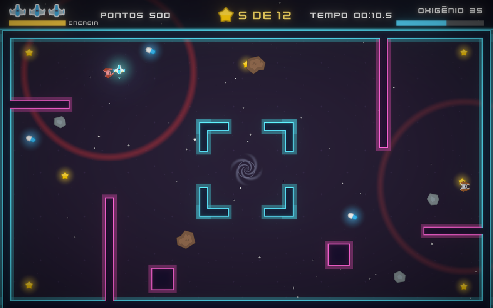

# Poeira Estelar

Jogo 2D feito em Unity para o **Projeto Introdução ao Unity (Tutorial)** da disciplina de Jogos Digitais do Insper.

**Aluno:** Miguel Fernandes Oliveira Damásio

- **Jogar no navegador (itch.io):** ITCH_URL
- **Repositório:** REPO_URL

## Sobre o jogo

Você pilota uma pequena nave presa em uma estação abandonada. Colete todas as **estrelas** para abrir o **portal** no centro da arena e escape por ele, antes que o **oxigênio** acabe. Meteoros cruzam a arena em rotas fixas e drones de segurança perseguem você quando te veem.

## Como jogar

| Ação | Teclado | Controle (Xbox) |
| --- | --- | --- |
| Mover | WASD ou setas | Analógico esquerdo ou direcional |
| Impulso (gasta energia) | Espaço ou Shift | A ou RT |
| Pausar | Esc ou P | Start |
| Navegar nos menus | Setas + Enter, ou mouse | Analógico + A |

- O **oxigênio** diminui o tempo todo. As **cápsulas azuis** dão +10 s e reaparecem depois de 15 s.
- O **impulso** atravessa rapidamente áreas perigosas, mas gasta a barra de **energia**, que recarrega sozinha.
- **Meteoros** seguem rotas fixas. **Drones vermelhos** patrulham e passam a perseguir quando você entra no radar deles (o círculo vermelho) sem parede no caminho. Os inimigos ficam mais rápidos conforme você coleta estrelas.
- Você tem **3 vidas**. Ao levar dano, a nave fica alguns instantes invencível.
- Pontuação: 100 por estrela, mais um bônus pelo oxigênio que sobrar e pelas vidas restantes. O melhor tempo fica salvo.

## Tutorial (Introdução Rápida)

Todos os passos do tutorial estão no projeto:

- Projeto **Universal 2D**, abas Project, Hierarchy, Inspector, Scene e Game, cor de fundo da câmera.
- Jogador com **Rigidbody 2D** (gravidade zero) e **Circle Collider 2D**; paredes com **Box Collider 2D**.
- Script `PlayerMovement` (ciclo de vida `Start`/`Update`/`FixedUpdate`), velocidade pública ajustável no Inspector e **movimentação diagonal normalizada**.
- Coletáveis com **Polygon Collider 2D** em modo **Is Trigger**, tag `Coletavel` e `OnTriggerEnter2D` destruindo o objeto.
- **Prefabs** para jogador, estrelas, cápsulas, meteoros, drones, paredes e portal.
- **Áudio**: AudioSource no jogador tocando o som da coleta.
- **Menu inicial** e **GameManager** estático controlando o fim de jogo.

## Rubrica: itens implementados

| Item | Onde está |
| --- | --- |
| **Mecânica de tempo** | Cronômetro na tela (`TEMPO`), tempo final e melhor tempo na tela de fim, e o **oxigênio** é uma contagem regressiva que encerra a partida, recarregada pelas cápsulas |
| **Inimigos** | Meteoros com rotas pré-determinadas (`EnemyPatrol`) e drones que patrulham e perseguem o jogador (`EnemyChaser`), causando dano e empurrão |
| **Visual** | Sprites básicos (quadrado, círculo, anel) com novas cores nas paredes neon, radar e portal; sprites da Kenney com estilo único em todo o jogo; bloom, vinheta, partículas e rastro |
| **Áudio** | Música própria em loop e efeitos para coleta, oxigênio, impulso, dano, alerta de oxigênio baixo, portal, vitória, derrota e botões |
| **UI** | Pontuação, estrelas e tempo atual sempre visíveis; também vidas, barra de energia (stamina) e barra de oxigênio |
| **Controles** | Suporte completo a controle Xbox/gamepad (jogo e menus) pelo Input System |
| **Level design** | Tema espacial; arena nova com salas, corredores e uma câmara central; novos desafios (oxigênio, inimigos que aceleram, portal que só abre no fim) |
| **Menu inicial** | Menu no mesmo tema, com instruções e recorde |
| **Sem dead-end/softlock** | Sempre há saída: pausa (continuar, reiniciar, menu), tela de vitória/derrota com "Jogar de novo" e "Menu"; o oxigênio garante que toda partida termina; a cena não tem áreas inalcançáveis |

## Estrutura

- `Assets/Scripts`: código do jogo (`Core`, `Player`, `Enemies`, `World`, `UI`)
- `Assets/Prefabs`, `Assets/Scenes` (`MainMenu`, `Game`)
- `Assets/Editor`: scripts de editor que configuram os assets e montam as cenas (menu **Poeira Estelar** no Unity)
- `Tools/gerar_musica.py`: gera a trilha sonora (synthwave em loop) a partir de código

Feito com **Unity 6.6 (6000.6.4f1)**. Para gerar o build: *File > Build Profiles > Web*.

## Créditos

- **Sprites, interface e fontes:** [Kenney](https://kenney.nl): [Space Shooter Remastered](https://kenney.nl/assets/space-shooter-remastered), [UI Pack: Sci-Fi](https://kenney.nl/assets/ui-pack-sci-fi), [Planets](https://kenney.nl/assets/planets) e a fonte Kenney Future. Licença **CC0**.
- **Efeitos sonoros:** Kenney: [Sci-Fi Sounds](https://kenney.nl/assets/sci-fi-sounds), [Interface Sounds](https://kenney.nl/assets/interface-sounds), [Music Jingles](https://kenney.nl/assets/music-jingles) e os sons do Space Shooter. Licença **CC0**.
- **Música:** original, gerada pelo script `Tools/gerar_musica.py` deste repositório.
- **Formas básicas** (quadrado, círculo, anel, brilho e vórtice): geradas para este projeto.
- **Ferramentas:** Unity 6, [MCP for Unity](https://github.com/CoplayDev/unity-mcp) (CoplayDev, MIT) e Claude Code (Anthropic) como assistente de desenvolvimento.
- **Tutorial base:** "Introdução Rápida", Profs. Tiago Sanches e Gustavo Braga, Insper.
